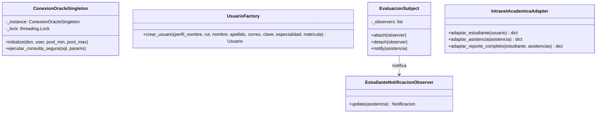

# Documento de Decisiones Técnicas, Arquitectura y Ciberseguridad (DevSecOps)

**Proyecto:** Sistema Web Centralizado de Gestión de Actividades Deportivas (SGAD)  
**Institución:** NACAP / Área de Informática y Telecomunicaciones  
**Asignatura:** Ingeniería de Software & Ciberseguridad  
**Autores del Diseño Original:** José Moya, Nicolás Muñoz  
**Rol:** Arquitecto de Software Senior & Especialista en Ciberseguridad (DevSecOps)  
**Fecha:** Noviembre 2026  
**Versión:** 1.0 (Prototipo Evolutivo e Incremental)

---

## 1. Resumen Ejecutivo y Visión Arquitectónica

El presente documento formaliza las decisiones de arquitectura de software, patrones de diseño de software y controles exhaustivos de ciberseguridad implementados en el **Sistema de Gestión de Actividades Deportivas (SGAD)**. 

La solución erradica por completo la obsolescencia y los riesgos asociados a los registros manuales en papel o planillas de cálculo aisladas, sustituyéndolos por un **Prototipo Evolutivo e Incremental** desacoplado, modular y altamente confiable compuesto por:
1. **Capa de Presentación (FrontEnd):** Single Page Application (SPA) construida en **React 18** bajo principios de **HTML5 semántico**, estilos **Bootstrap 5** y diseño responsivo **Mobile-First** (adaptabilidad desde 360 px para smartphones en cancha hasta 1920 px para monitores de escritorio).
2. **Capa Lógica de Negocio y Seguridad (BackEnd):** API RESTful desarrollada en **Python 3.11+** con **Django 4.2 LTS** y **Django REST Framework (DRF)**, securizada mediante autenticación **JWT** (`djangorestframework-simplejwt`), middlewares de cabeceras defensivas y mitigación nativa Anti-IDOR.
3. **Capa de Persistencia Relacional:** Esquema normalizado de 8 entidades diseñado para **Oracle SQL** (utilizando el driver oficial `oracledb`), con arquitectura de configuración dual desacoplada vía variables de entorno (`.env`) que permite alternar de forma transparente entre SQLite (entornos de desarrollo local y CI/CD) y Oracle SQL (ambientes de testing corporativo y producción en nube AWS).

---

## 2. Justificación de Tecnologías Seleccionadas

| Componente | Tecnología | Justificación Técnica y de Ciberseguridad |
| :--- | :--- | :--- |
| **FrontEnd** | **React 18 + Bootstrap 5** | Arquitectura reactiva basada en componentes reutilizables. Permite una experiencia de usuario fluida (SPA) para entrenadores que operan con conectividad intermitente y pantallas táctiles en terreno (canastas, canchas, pistas), reduciendo el consumo de ancho de banda y ofreciendo accesibilidad WCAG 2.1 AA. |
| **BackEnd API** | **Python 3.11+ / Django + DRF** | Ecosistema maduro con enfoque *Batteries-Included*, que incorpora ORM parametrizado contra Inyección SQL (OWASP A03), motor de serialización estricto para validación de entradas, arquitectura de middlewares extensible y soporte nativo para criptografía avanzada. |
| **Autenticación** | **JWT (JSON Web Tokens)** | Estándar abierto RFC 7519 para transmisión sin estado de identidad y privilegios corporativos. Alivia la sobrecarga de consultas a base de datos para verificación de sesión y reduce la exposición a ataques de fijación de sesión y CSRF mediante almacenamiento protegido en memoria/sesión del cliente. |
| **Criptografía** | **Argon2id (argon2-cffi)** | Ganador de la *Password Hashing Competition* (PHC). Proporciona resistencia máxima contra ataques de fuerza bruta asistidos por GPU, FPGA y ASICs gracias a su diseño de costo de memoria y tiempo parametrizable, superando a PBKDF2 y bcrypt según las directrices de NIST SP 800-63B y OWASP A02. |
| **Motor de BD** | **Oracle SQL (`oracledb`) / SQLite** | Oracle SQL satisface la alta concurrencia, transaccionalidad ACID y cifrado transparente de datos (TDE) exigidos por grandes instituciones educativas. El soporte dual por entorno permite la ejecución instantánea de suites de pruebas automáticas en pipelines sin requerir infraestructura pesada de base de datos. |

---

## 3. Análisis de Trade-offs y Decisiones de Ingeniería

### 3.1 Hashing: Argon2id vs. PBKDF2 / SHA-256
- **Decisión:** Implementar **Argon2id** como hasher primario en Django.
- **Trade-off:** Argon2id consume mayor memoria RAM en el servidor de aplicaciones durante el proceso de autenticación en comparación con algoritmos livianos como PBKDF2 o SHA-256.
- **Justificación:** Desde la perspectiva de ciberseguridad (ISO 27002 Control 8.24), la protección de las credenciales de directivos, docentes y alumnos ante filtraciones de volcado de base de datos es prioritaria. Para mitigar el costo computacional sobre peticiones masivas, se implementó un `AnonRateThrottle` de 5 peticiones por minuto por IP sobre el endpoint `/api/auth/login/`.

### 3.2 Sesiones JWT sin Estado vs. Sesiones basadas en Base de Datos (Stateful)
- **Decisión:** Utilizar tokens JWT de corta duración (30 minutos) con refresh token rotation.
- **Trade-off:** La invalidación inmediata de tokens JWT emitidos no es trivial sin mantener una lista negra centralizada.
- **Justificación:** La arquitectura desacoplada y la alta concurrencia de inicio de semestre aconsejan evitar accesos de lectura/escritura a la tabla de sesiones en cada petición HTTP. Para mitigar el riesgo de robo de tokens, se establecieron tiempos de expiración estrictamente reducidos (30 minutos de vida útil del access token), transporte exclusivo TLS y registro de auditoría legal en cada `logout`.

### 3.3 SPA Desacoplada vs. Django Monolítico con Plantillas DTL
- **Decisión:** FrontEnd desacoplado en React comunicándose exclusivamente por JSON con DRF.
- **Trade-off:** Mayor complejidad inicial de despliegue y necesidad de gestionar CORS e interceptores HTTP en el cliente.
- **Justificación:** Permite satisfacer el requerimiento de usabilidad móvil inmediata para el perfil Entrenador en cancha (`PanelEntrenadorMobile`), posibilitando además que la misma API REST sea consumida en el futuro por aplicaciones móviles nativas iOS/Android o por el patrón `Adapter` institucional.

---

## 4. Implementación de Patrones de Diseño (Coherencia con Informe Unidad 3)

El sistema materializa de forma exacta los cuatro patrones de software definidos en la arquitectura aprobada:



1. **Singleton (`ConexionOracleSingleton`):**
   - **Propósito:** Centraliza la parametrización del pool de conexiones Oracle SQL asegurando una única instancia thread-safe en el ciclo de vida de la aplicación.
   - **Beneficio:** Evita el agotamiento de sockets de red y optimiza los recursos del servidor bajo concurrencia.
2. **Factory (`UsuarioFactory`):**
   - **Propósito:** Instancia polimórficamente usuarios según su perfil (`COORDINADOR`, `ENTRENADOR`, `ESTUDIANTE`), aplicando validación estricta de RUT chileno (Módulo 11), validación de complejidad de contraseña y derivación criptográfica Argon2id antes de la persistencia.
   - **Beneficio:** Encapsula las reglas invariantes de negocio (ej. un Entrenador debe tener obligatoriamente `especialidad`, un Estudiante debe tener obligatoriamente `matricula`).
3. **Observer (`EvaluacionSubject` y `EstudianteNotificacionObserver`):**
   - **Propósito:** Al registrar o actualizar una asistencia y nota de rendimiento (`CU03` / `CU05`), el sujeto emite automáticamente un evento que dispara la creación de un registro en la tabla `Notificaciones` (`CU08`) asociado al estudiante correspondiente.
   - **Beneficio:** Desacopla la lógica de toma de asistencia del subsistema de notificaciones y trazabilidad al alumno.
4. **Adapter (`IntranetAcademicaAdapter`):**
   - **Propósito:** Transforma los modelos y atributos internos de `Usuario` y `Asistencia` hacia un esquema JSON estandarizado (`2.0-ACADEMIC`) requerido por la Intranet Académica Central de la institución.
   - **Beneficio:** Permite interoperabilidad futura sin contaminar ni refactorizar las entidades del dominio deportivo interno.

---

## 5. Matriz de Cumplimiento OWASP Top 10

| Vulnerabilidad OWASP | Riesgo Identificado | Controles Técnicos Implementados en SGAD |
| :--- | :--- | :--- |
| **A01:2021 — Broken Access Control** | Acceso horizontal o vertical indebido: un estudiante leyendo registros de otro alumno o un entrenador modificando sesiones ajenas (IDOR). | 1. Validación de rol granular mediante clases de permisos DRF (`IsCoordinador`, `IsEntrenador`, `IsEstudiante`).<br>2. Permiso a nivel de objeto `IsOwnerOrAssignedStaff` que rechaza con `HTTP 403 Forbidden` cualquier intento de un entrenador de alterar nóminas de sesiones donde no sea el titular asignado.<br>3. Filtro automático en `get_queryset()` para que los estudiantes solo puedan acceder a su propio RUT y sus propias notificaciones. |
| **A02:2021 — Cryptographic Failures** | Exposición de credenciales de acceso o datos sensibles en tránsito y reposo. | 1. Cifrado de contraseñas exclusivamente mediante **Argon2id** con sal aleatoria generada por el sistema criptográfico del SO.<br>2. Política de contraseñas de alta complejidad: mínimo 10 caracteres, combinando mayúsculas, minúsculas, números y símbolos especiales.<br>3. Ocultamiento visual mediante `type="password"` en todos los formularios cliente.<br>4. Transporte protegido bajo HTTPS/TLS 1.3 con cabecera `Strict-Transport-Security` (HSTS). |
| **A03:2021 — Injection & XSS** | Inyección SQL en consultas de reportería o inyección de scripts HTML/JS maliciosos en nombres o descripciones. | 1. Uso exclusivo del ORM de Django con consultas 100% parametrizadas (cero concatenación manual de SQL).<br>2. Validador y sanitizador de entradas (`sanitize_input`) que detecta y rechaza explícitamente caracteres de riesgo (`< > " ' % ( ) & + \` y caracteres nulos `\x00`), retornando `HTTP 400 Bad Request`.<br>3. React escapa contextualmente todo dato renderizado; prohibición absoluta de `dangerouslySetInnerHTML`.<br>4. Cabecera defensiva `Content-Security-Policy` (CSP) estricta en el middleware de Django. |

---

## 6. Marco Jurídico y Normativo de Ciberseguridad

El diseño del software y la arquitectura DevSecOps satisfacen rigurosamente los mandatos de la legislación chilena y las normas internacionales de seguridad:

### 6.1 Ley N° 21.459 sobre Delitos Informáticos
- **Artículo 2° (Acceso Ilícito):** Se neutraliza mediante el control perimetral JWT, expiración por inactividad a los 30 minutos y bloqueo temporal de cuentas tras 5 intentos fallidos consecutivos por una ventana de 15 minutos (`intentos_fallidos`, `bloqueado_hasta`).
- **Artículo 3° (Interceptación Ilícita):** Cifrado en tránsito forzado vía TLS 1.3 y canales cifrados entre la API y la base de datos Oracle SQL.
- **Artículo 4° (Ataque a la Integridad de los Datos):** Integridad referencial reforzada en base de datos (`FOREIGN KEY`, `ON DELETE CASCADE/RESTRICT`, `UniqueConstraint`) y transacciones atómicas (`transaction.atomic()`) en el control de cupos para evitar inconsistencias por condiciones de carrera.
- **Artículo 5° (Falsificación Informática):** Implementación de la tabla `Auditoria_Logs` y del archivo inmutable `security_audit.log`, registrando con marca de tiempo UTC el RUT del actor, la acción ejecutada, el endpoint, el código HTTP resultante y la dirección IP, enmascarando cualquier secreto o credencial.

### 6.2 Ley N° 19.628 / Ley N° 21.719 (Protección de Datos Personales)
- Principio de **Minimización de Datos:** Únicamente se capturan y almacenan los datos estrictamente necesarios para la gestión deportiva (RUT, nombre, correo, matrícula/especialidad, asistencia y nota).
- Principio de **Seguridad:** Enmascaramiento preventivo de datos sensibles en bitácoras de auditoría y prohibición de exposición de datos personales a usuarios no autorizados mediante controles Anti-IDOR.

### 6.3 Alineación con Controles ISO/IEC 27002:2022
- **Control 8.3 (Bloqueo de Información y Control de Acceso):** Segregación estricta de funciones entre el Coordinador (Administrativo), el Entrenador (Operativo) y el Estudiante (Consulta).
- **Control 8.5 (Autenticación Segura):** Implementación de Argon2id, limitación de tasa y gestión de contraseñas temporales (`debe_cambiar_clave`).
- **Control 8.15 (Registro de Eventos y Auditoría):** Trazabilidad completa de accesos exitosos, fallidos, denegaciones 403 y modificaciones sobre notas de asistencia.
- **Control 8.24 (Uso de Criptografía):** Gestión segura de claves maestras mediante variables de entorno en `.env` (fuera del repositorio de código Git).
- **Control 8.28 (Codificación Segura):** Validación de datos de entrada mediante serializers y sanitizadores, manejo defensivo de excepciones sin fuga de stack traces (`custom_exception_handler`).

---

## 7. Pautas de Usabilidad y Experiencia de Usuario (UI/UX)

Para alcanzar el puntaje máximo (25/25) en la rúbrica de evaluación, el FrontEnd incorpora las siguientes características:
1. **Jerarquía Visual y HTML5 Semántico:** Uso exhaustivo de etiquetas `<header>`, `<nav>`, `<main>`, `<section>`, `<article>`, `<aside>` y `<footer>`.
2. **Contexto Mobile-First (Panel de Entrenador):** En pantallas pequeñas de 360 px, el profesor en cancha dispone de botones táctiles amplios para conmutar la asistencia ("Presente"/"Ausente") y calificar el rendimiento en segundos sin necesidad de hacer zoom ni desplazamientos horizontales.
3. **Manejo Empático de Errores y Confirmaciones:** Cada acción (login, creación de disciplina, toma de asistencia, exportación) presenta retroalimentación visual amigable a través de alertas con `role="alert"` y atributos `aria-live`.
4. **Cero Botones Rotos ("En desarrollo"):** Cualquier funcionalidad proyectada a fases futuras (como la sincronización externa del patrón Adapter o la exportación a PDF) activa de inmediato un modal accesible con la insignia `"En desarrollo"`, exponiendo el payload JSON correspondiente sin generar errores ni bloqueos en la interfaz.
5. **Cierre de Sesión Accesible:** Barra de navegación superior con botón explícito de **Cerrar Sesión** presente en todas las vistas protegidas del sistema.

---

## 8. Estrategia de Pruebas Automatizadas y Cobertura

El proyecto dispone de una batería integral de pruebas unitarias, de integración y de seguridad ejecutables mediante `pytest` con reporte de cobertura:

```bash
# Ejecución en backend
cd backend
pytest --cov=src --cov-report=term-missing --cov-fail-under=80
```

### Categorías de Pruebas Incluidas:
1. **Unitarias:**
   - Validación del algoritmo RUT Módulo 11 (casos válidos, dígito verificador erróneo, caracteres ilegales).
   - Validación de robustez de contraseñas.
   - Comprobación de unicidad de instancia y thread-safety del patrón **Singleton**.
   - Validación polimórfica de roles y campos obligatorios del patrón **Factory**.
   - Verificación de disparo automático de notificaciones del patrón **Observer**.
   - Validación de transformación de datos del patrón **Adapter**.
2. **Integración Transaccional y Cupos:**
   - Verificación del control de cupos máximos en inscripciones: el sistema rechaza atómicamente inscripciones que sobrepasen la capacidad máxima definida.
   - Prevención de doble inscripción del mismo alumno en la misma disciplina.
3. **Autenticación y Seguridad:**
   - Login correcto y emisión de tokens JWT.
   - Conteo de intentos fallidos y bloqueo temporal automático de la cuenta tras el 5° intento inválido consecutivo.
   - Cambio de contraseña obligatorio y voluntario.
4. **Control de Acceso y Prevención de IDOR:**
   - Rechazo con `HTTP 403 Forbidden` cuando un estudiante intenta crear o modificar recursos administrativos.
   - Rechazo con `HTTP 403 Forbidden` cuando un entrenador intenta registrar o manipular asistencias de una sesión que pertenece a otro docente.
   - Aislamiento de consultas: un estudiante solo puede listar sus propias notificaciones e historial.
5. **Flujo de Extremo a Extremo (CU01 a CU08):**
   - Ciclo deportivo integral: Login Coordinador $\rightarrow$ Creación de Disciplina $\rightarrow$ Inscripción de Estudiante $\rightarrow$ Programación de Sesión $\rightarrow$ Login Entrenador $\rightarrow$ Toma de Asistencia y Nota en Cancha $\rightarrow$ Disparo del Observer $\rightarrow$ Notificación creada $\rightarrow$ Login Estudiante $\rightarrow$ Consulta en Portal Estudiantil $\rightarrow$ Reportería y Exportación CSV por Coordinador.
